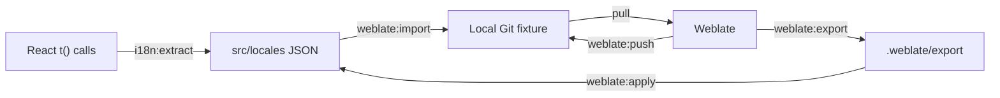

# i18next plural playground

A small React app and local Weblate setup for reproducing an English/Lithuanian i18next JSON v4 round trip: extract keys from code, import JSON into Weblate through Git, edit translations, and inspect the files pushed back to Git.

The pinned **Weblate 2026.10** instance was observed to expose three Lithuanian editor forms and remove fractional `_many` keys when saving plural entries. This repository makes that behavior reproducible and keeps the input, output, and verification report separate.

## Requirements

- Node.js **22.12 or newer**; Node.js 24 is used for local validation.
- Git on your command path.
- Docker with Compose v2 or newer, with the Docker engine running, for Weblate.
- Ports 5173 (React) and 8080 (Weblate) available. Vite prints an alternative port if 5173 is busy.

Run commands from the repository root. No GitHub account, remote repository, or external Weblate instance is needed. The Docker images require a download on first startup; dependencies are locked in `package-lock.json`, and container images are pinned by digest.

## Start the app and Weblate

After cloning this repository:

```sh
npm ci
npm run dev
```

Open the URL Vite prints, normally http://127.0.0.1:5173. Switch languages, enter a count, or use the presets. Fractions such as `1.5` exercise Lithuanian `_many`.

In another terminal, with Docker running:

```sh
npm run weblate:start
```

First startup can take several minutes. This seeds a local Git fixture, starts Weblate, PostgreSQL, Valkey, and a Git service, and imports the translation component. Subsequent starts retain the existing fixture and Weblate data.

| Setting | Value |
| --- | --- |
| Weblate URL | http://localhost:8080 |
| Username | `admin` |
| Password | `local-weblate-admin` |
| Lithuanian component | http://localhost:8080/projects/plural-playground/i18next-v4/lt/ |

These credentials are for this local demo. The UI listens on loopback; the database, cache, and Git service have no published ports. Email goes to the container log. The setup follows [Weblate's Docker installation](https://docs.weblate.org/en/latest/admin/install/docker.html).

## Extract → import → edit → push



1. Extract keys into the app's JSON and import them into Weblate:

   ```sh
   npm run i18n:extract
   npm run weblate:import
   ```

   The extractor preserves existing translations and creates missing keys with blank values. Review or fill those values before importing. If you edited `src/locales` directly, just run `weblate:import`; extraction is not required. Import commits the files to local Git and waits for Weblate to parse them.

2. Open the Lithuanian component, choose **Translate**, search for `apples`, and edit/save its plural forms.

3. Push the Weblate edits back to local Git and check the received keys:

   ```sh
   npm run weblate:push
   npm run i18n:check-pushed
   git -C .weblate/repository show HEAD -- src/locales
   ```

   Inspect `.weblate/repository/src/locales/lt/translation.json`. With the pinned version, editing a Lithuanian plural entry can remove its `_many` key. The key check exits with code 1 if a required form is missing, including when the translation would otherwise fall back at runtime.

**Inspect the pushed file before extracting again.** Extraction regenerates missing keys and can conceal what Weblate removed. It does not recover their translation values.

Pushes are manual by default. Both Weblate's pull and push URLs are `git://repository/repository`, using branch `main`. `weblate:push` commits pending edits and performs a real Git push to the Docker Git service. Git's [`updateInstead`](https://git-scm.com/docs/git-config#Documentation/git-config.txt-receivedenyCurrentBranch) setting updates the fixture's checked-out files when it receives a push; an uncommitted fixture change causes the push to be rejected.

## Inspect extraction and serialization separately

To generate a separate extraction preview:

```sh
npm run i18n:preview
```

Open `.weblate/extracted/lt/translation.json`. A fresh preview contains `apples_many`, `messages_many`, and `files_many`, with blank Lithuanian values. Preview extraction merges with its own previous output on later runs. It does not import anything into Weblate.

The [official i18next CLI](https://github.com/i18next/i18next-cli) reads `i18next.config.js`, with `locales: ['en', 'lt']`. Literal calls such as `t('apples', { count })` make plural use visible to static extraction; the CLI generates the language-specific suffixes. English defaults in the React calls provide source plural text. Lithuanian values must be translated.

To inspect Weblate's JSON writer before pushing:

```sh
npm run weblate:export
```

This commits pending Weblate edits and writes the actual repository file contents, including their formatting, into `.weblate/export/en/translation.json` and `.weblate/export/lt/translation.json`. It lists keys that differ from the app's JSON. It does not push or update the React files.

To replace the app's translations with those exports:

```sh
npm run weblate:apply
npm test
```

`weblate:apply` overwrites both `src/locales` JSON files with the last export. The app tests fail if required plural forms or `{{count}}` placeholders are missing. They allow translation wording to change. Missing `_many` can resolve to `_other` in the UI, so the tests and file inspection are needed as well.

## Automated reproduction

```sh
npm run weblate:verify
```

The verifier commits pending edits, snapshots the Lithuanian JSON, temporarily edits the three sample plural entries through Weblate's REST editor, and flushes the JSON writer. It saves:

- `.weblate/verification.json`: input, output, form counts, removed/added keys, and restoration status.
- `.weblate/round-trip/lt/translation.json`: the JSON written after the temporary edits.

It then restores the original JSON in Weblate and parses it again. Test and restoration commits remain in Weblate history but are not pushed automatically. Start with all four forms for each sample present in Weblate; if keys are already missing, extract/fill/import them first.

In the pinned Weblate 2026.10 instance, the test reproduced removal of `apples_many`, `messages_many`, and `files_many`. The visible `_one`, `_few`, and `_other` forms and their placeholders were saved correctly. **Exit code 1 is expected for this reproduced failure.** A complete round trip returns 0; setup or restoration errors are also reported as failures. This result applies to the pinned version and this fixture.

## Command reference

| Command | Purpose |
| --- | --- |
| `npm run dev` | Run the React app with live updates. |
| `npm test` | Check translated plural completeness and runtime selection. |
| `npm run build` | Build the app into `dist`. |
| `npm run preview` | Serve the built app locally. |
| `npm run i18n:extract` | Merge code-extracted keys into `src/locales`. |
| `npm run i18n:preview` | Generate a separate extraction preview. |
| `npm run i18n:check-pushed` | Check plural key presence in local Git; blank values are allowed. |
| `npm run weblate:start` | Start/resume containers and create the component if needed. |
| `npm run weblate:import` | Commit app JSON into local Git, then pull/parse it in Weblate. |
| `npm run weblate:push` | Commit Weblate edits and push them to local Git. |
| `npm run weblate:git` | Show the fixture's recent commits and working-tree status. |
| `npm run weblate:verify` | Run the temporary edit/serialize/restore check. |
| `npm run weblate:export` | Copy Weblate's current repository JSON into `.weblate/export`. |
| `npm run weblate:apply` | Replace app JSON with the last exported files. |
| `npm run weblate:logs` | Follow Weblate logs; press Ctrl+C to stop following. |
| `npm run weblate:stop` | Stop containers while retaining their data. |

## Plural rules and Weblate configuration

| Language | Suffixes | Examples |
| --- | --- | --- |
| English | `_one`, `_other` | 1 → one; 0, 2, 1.5 → other |
| Lithuanian | `_one`, `_few`, `_many`, `_other` | 1, 21 → one; 2, 22 → few; 1.5 → many; 0, 10, 11 → other |

The app uses [i18next JSON v4](https://www.i18next.com/translation-function/plurals) and `Intl.PluralRules`. There is no `_zero` override. Language fallback is disabled; i18next's own plural resolution can still use `_other` when a specific form is missing.

For another Weblate instance, configure:

| Setting | Value |
| --- | --- |
| File format | i18next JSON file **v4** (`i18nextv4`) |
| File mask | `src/locales/*/translation.json` |
| Monolingual base language file | `src/locales/en/translation.json` |
| Source language | English (`en`) |

Choose v4 explicitly rather than v3 or generic JSON; see [Weblate's i18next documentation](https://docs.weblate.org/en/latest/formats/i18next.html).

## Troubleshooting and local data

- **Docker unavailable:** start Docker Desktop or your Docker engine, then rerun `weblate:start`.
- **Startup fails or times out:** run `weblate:logs`. Check port availability and Docker's available memory.
- **Port 8080 is occupied:** set `WEBLATE_PORT=8081` in your shell before running Weblate commands. Open http://localhost:8081 instead. Keep that setting for later commands.
- **Import or push conflicts:** inspect the component's repository alerts. Both the app and Weblate can edit the same keys; the scripts do not force-push or reset history.
- **Fixture has uncommitted edits:** inspect `git -C .weblate/repository status`; commit or resolve those changes before importing or pushing.

All generated fixtures, previews, exports, and reports live in the ignored `.weblate/` directory. Weblate's database, working repositories, and caches live in named Docker volumes. Stopping the containers preserves them. Sharing this repository shares the setup and sample JSON, not your local Weblate database or generated reports.

For independent instances, use separate checkouts and different `COMPOSE_PROJECT_NAME` and `WEBLATE_PORT` environment values. Keep those values set for every command belonging to that instance.
